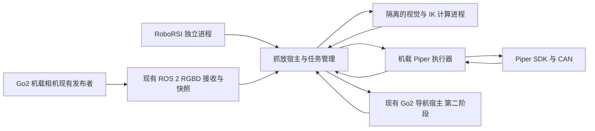

# Go2 机载 Piper 抓放与携带接入方案

日期：2026-11-10。状态：**接入设计草案，尚未实施或完成现场验收**。

目标是把 `~/机械臂资料` 的标定、视觉、运动学和动作代码接入现有 VLM_Nav 与 RoboRSI。用户已确定使用 Go2 身上的相机和 Piper；首版完成原地 pick and place，后续增加抓起后携物导航、到目的地再放置。

推荐采用局部适配：控制电脑保留 ROS 2 Humble 导航栈和独立 RoboRSI 环境，新增隔离的机械臂计算进程；机载端保留 Piper SDK 执行与反馈。复用算法，替换旧设备入口、硬编码配置和任务协议。本文中的新增工具、协议、目录、状态均是拟议设计，不是当前已有接口。

“两端”在本文中指 **A 端：当前控制电脑**，**B 端：Go2 机载 Piper 执行电脑**。相机发布者实际运行在哪台机载电脑、是否与 Piper 在同一系统，仍须核实；不能把整个 Go2 上的多个计算单元当成同一 Python/ROS 环境。Ranger 不属于此次机械臂接入两端。

## 1 范围与证据等级

| 等级 | 含义 | 本文使用范围 |
| --- | --- | --- |
| 本轮及同会话已核实 | 本地源码、配置、离线导入与安装检查 | 工具包调用链、A 端安装路径和框架接口 |
| 用户提供的检查结果 | 用户已完成的本机依赖检查，本轮未逐项重跑 | CUDA 不可用、缺少若干库、ROS 1 工具不完整、样本格式检查 |
| 历史实机记录 | 2026-11-06 的机载核验与实验 | B 端 Python/SDK/固件、CAN、夹爪动作未响应 |
| 设计建议或待验证 | 本方案拟议实现与现场待测项 | 新工具、通信协议、抓放/携带状态、实际标定及停止行为 |

首版包括现有机载相机观察、目标与放置区域定位、抓取、原地转移、释放和结果核验。操作者预先把 Go2 放在目标与放置区域可观测且可达的位置；首版不把自主寻找停车位列入验收。首个物体、起点、放置区域和姿态尚未指定，不默认沿用之前杯子的目测尺寸，也不假设必须从地面抓取。

第二阶段复用首版的抓取与放置能力，加入持物状态交接、携物导航和到达后重新观察。暂不实现双臂、抽屉/门等关节物体操作、Ranger 操作任务、新 global VLM planner 或新的共享地图。

## 2 当前环境与安装基线

### 2.1 A 端控制电脑

仓库 `/home/isee-pst/unitree_ros2/VLM_Nav`，分支 `go2-cooperative-task-layer`，HEAD `323d5c52737477962a874ae012db117be5a93f34`。当前有大量未提交工作；本方案以实际工作树和安装检查为准，不能仅凭 HEAD 重建当前功能。

| 项目 | 已确认基线 | 接入影响 |
| --- | --- | --- |
| 系统 | Ubuntu 22.04.5，x86_64，ROS 2 Humble | 保留现有导航部署 |
| 导航 Python | `/home/isee-pst/venv/co-nav-real/bin/python`，3.10.12 | 现有 ROS 执行器 shebang 指向这里，不以终端是否 activate 判断实际解释器 |
| 导航主要库 | NumPy 1.26.4、OpenCV Python 4.11.0.86、PyYAML 6.0.3、rclpy 3.3.21 | 新增感知/IK 依赖不直接升级此环境 |
| RoboRSI | `/home/isee-pst/unitree_ros2/SenseNova-RoboRSI`，HEAD `0208cd72ec7c885a7219040cd2be459d127e374e`，工作树干净 | 本地预检要求 HEAD、工作树、导入来源匹配 |
| 框架 Python | RoboRSI `.venv/bin/python`，3.10.12；NumPy 2.2.6、MCP 1.30.0、pydantic 2.14.2 | 与导航环境分开，不能认为两个 Python 3.10 环境可交换 |
| 框架配置 | `gpt-6-astra` / `high`，max_turns/max_tokens/planner_timeout_s 为 null | action_timeout_s=600 不约束同步 LocalToolSpec handler |
| Codex CLI | 配置要求 0.166.0，实际绝对路径解析为 0.167.0 | 同会话预检失败；须选择并验证兼容版本，不能仅跳过版本检查 |
| Piper 本地依赖 | 导航和框架环境均未安装 piper-sdk、python-can | CAN 保留在 B 端时，A 端计算不必因此安装 SDK |
| GPU | 用户检查 NVIDIA 驱动不可用，PyTorch CUDA false | 旧入口强制 cuda:0 无法照搬；CPU 感知可用性和耗时待测 |

默认环境入口为 [CoVLM_env.bash](../../../CoVLM_env.bash)；显式 `COOP_SETUP_FILE` 优先于默认。加载顺序是 Humble、Hesai overlay、Go2 overlay、`build/go2-coop/install/local_setup.bash`、选定任务 overlay、Go2 网络环境。不能最后再 source 旧功能 overlay 覆盖当前安装。

| 安装 | 同会话检查结果 | 设计处置 |
| --- | --- | --- |
| 默认 `build/go2-dual-recovery-sync-20261105/overlay/install/local_setup.bash` | 59 个 Python 模块均与源码一致；缺少 `config/piper_boot/piper-boot.service`、`piper.json`，完整 check-install 退出 1 | 实施阶段修复完整安装一致性并核对两个入口；本轮未切换 |
| 最新构建 `build/go2-piper-gripper-20261106/overlay/install/local_setup.bash` | 同样 59 个模块一致，完整 check-install 退出 0，三包 prefix 均在该输出 | 可作为后续候选基线；日期最新不代表当前默认或已现场验收 |

现有 Go2 本地 ROS 为 Domain0、CycloneDDS、`enp4s0`；Domain40 只承担高层协同、走 `wlo1`；Domain31 用于隔离 mock。11 月 10 日采集时 `enp4s0` 为 DOWN 且无机器人网段地址，环境入口网络检查失败；这不是 Piper SDK 故障。网络状态运行前必须重新读取。

### 2.2 B 端机载执行电脑

以下是 **11 月 6 日历史记录，未在本轮 SSH 复查**：

| 项目 | 历史基线 | 需对齐事项 |
| --- | --- | --- |
| 系统与 Python | aarch64、Python 3.8.10，存在 Foxy/Noetic 安装目录 | 不默认其可运行 A 端 Humble 二进制或 Python 3.10 包 |
| Piper 环境 | `/home/unitree/piper-venv/bin/python -I`；SDK 0.6.2、python-can 4.5.0 | 固定实际 import 来源、版本和依赖清单 |
| SDK 类 | `C_PiperInterface_V2` | 旧采集器的 `C_PiperInterface` 需要核对，不能混用 |
| 设备 | USB 身份由 `/opt/piper-boot/piper.json` 指定；历史接口 can0，1 Mbps | 按 USB 身份找接口，不永久假设名称 can0 |
| 固件 | 主控 S-V1.8-2、硬件 H-V1.2-1；夹爪电机固件/内部 ID 未知 | 不由主控版本推断夹爪版本，不随方案升级固件 |
| 已有入口 | `/opt/piper-boot/go2_piper_boot.py`；夹爪调试部署于 `/home/unitree/piper-gripper-debug-20261106` | 不能让新执行器与调试程序同时控制同一机械臂 |
| 动作结果 | 夹爪校零后反馈偏差纠正；10 mm / 0.5 N·m 单发及有界周期发送仍无位置变化 | 原动作故障未解决；不能把已使能或 CAN TX 增加当成抓取通过 |

## 3 工具包逐项匹配

原资料位于 [机械臂资料](/home/isee-pst/机械臂资料/桌面操作和标定.md)。该目录作为来源保留；适配代码进入本仓库，记录来源文件摘要，不直接把整份资料加入 PYTHONPATH 或 overlay。

| 模块或资源 | 当前行为与不匹配 | 拟议处置 | 负责端 |
| --- | --- | --- | --- |
| `agent/main_robot.py` | 自定义 TCP 客户端，连接旧控制器；单次 recv(1024) 后直接解析 JSON；每条命令开线程 | 仅参考任务入口，不沿用旧控制器/IP/协议；补明确分帧、串行执行、身份与取消语义 | A/B |
| `agent/main4.py` | 视觉规划、SAM、动态动作模块执行、重试和回位耦合；硬编码路径与 cuda:0 | 提取抓放调用链；与 RoboRSI 的上层编排分开；不直接运行脚本末尾示例 | A |
| `agent/vlm_agent.py`、`prompt/` | 多模型 SDK 顶层导入，提示词/日志路径固定，生成 Python 动作代码 | 保留需要的识别/关键点/抓放知识；先选实际使用的模型路径，再安装对应 SDK；动作改为明确参数的固定原语调用 | A |
| `agent/dino2.py` | 检测通过外部 HTTP 服务，不是已有本地 DINO 权重即可运行；代理端口写死 | 核对所选检测路径、凭据来源、超时和图像发送范围；不把代理监听当成云端已连通 | A |
| `generate_keypoints2.py`、SAM 权重 | 可复用分割/关键点算法；依赖 segment_anything、图像/点云关联和字体路径 | 固定权重摘要、输入分辨率和像素映射；GPU/CPU 分别测量，不声称 CPU 已满足运行时限 | A |
| `pointcloud2.py`、`util.get_point_cloud_and_rgb` | 直接打开写死序列号的 USB 相机；含旧内外参及坐标约定 | 改接现有机载 RGB-D 快照；保留必要反投影算法，不另启同一相机或常驻完整点云诊断 | A，相机端配合 |
| `primitive3.py` | 导入时创建 PiperRobot、解析进程参数；含抓放和无关关节物体动作；TCP=0.135 m 等写死 | 移除导入时硬件副作用；首版仅移植抓取/转移/放置所需原语与错误反馈 | A/B |
| `aloha/piper_arm.py`、`piper_robot.py` | 构造即 ConnectPort/EnableArm；夹爪动作会写 MotionCtrl_2；goto_joint 超时只 break 后仍返回目标关节；move_home 含旧角度且先开爪 | 不能原样作为执行器；初始化、模式切换、到位、失败和停止分别处理；持物时不自动回位开爪 | B |
| `ik_solver.py`、`main_caller.py` | 同时存在进程内和另一 Python 子进程调用；路径指向 isee604/agilex；IK 返回角度为度；失败结果处理不完整 | 统一为 A 端单一计算入口，明确无解结果及单位；传入完整 3D 位姿，结果不直接视为无碰撞路径 | A |
| `_external/pyroki` | Python ≥3.10；JAX/jaxlie/jaxls/yourdfpy 等未就绪；jaxls 来源是未锁定 Git 地址 | A 端独立环境固定源码/依赖版本；不上 B 端 Python 3.8 环境；CPU IK 可先离线核对 | A |
| `piper_pinocchio/`、URDF | 多个 old/no_gripper/带相机模型；文件存在不代表型号/零位匹配 | 选择与实机相符的一份模型，校验关节序、零位、限位、法兰/TCP、机身干涉；不同时启用多个 IK 实现 | A/B |
| AnyGrasp 相关代码 | 存在配置和旧函数；多处实际初始化/导入已注释，不能据目录名认定在用 | 按首个物体选定的真实路径核对；不默认新增 AnyGrasp 依赖或宣称其分支完整可用 | A |
| `experience_pool.py`、`experience_action.py` | 本地 pickle/动作经验缓存，可能包含旧场景几何或生成代码 | 首版不自动重放旧动作缓存；若复用，只作为参考，使用当前图像/标定重新求解 | A |
| `calibration_toolbox` ROS 采集器 | rospy/TF/服务依赖；yumipy/Panda 残留、断点；构造即回零开爪；CMake 安装的是通用 scripts，非 scripts/1 | 改接现有图像与 B 端反馈；采集和运动分离，不能用启动采集器代替显式动作 | A/B |
| `axxb.py`、标定求解入口 | 求解主体只依赖 NumPy/YAML/本地数学；入口初始化 ROS、循环1001次且 write_pose_file 参数不匹配 | 复用离线求解；修正导出契约，输出到新数据目录，不覆盖原样本/外参 | A |
| `piper_calibrate.zip` | 含录点脚本、26行角度、20组样本和旧外参；格式检查由用户提供 | 用于离线格式/算法回归；实际机载标定重新采集，不回放旧角度控制 Go2 上的机械臂 | A/B |

用户提供的缺失库清单与上述调用链一致，但不是一次性安装清单：`piper_sdk/python-can` 属于设备执行层，`pyrealsense2` 取决于是否直接控制相机，`google.genai/Ark` 取决于选定模型；旧 MoveIt/yumipy 依赖优先去除不再使用的导入。`autolab_core` 若保留 RigidTransform 接口则需要；SAM 路径需要 segment_anything。

## 4 方案选择与进程边界

| 路线 | 收益与代价 | 本方案结论 |
| --- | --- | --- |
| 局部适配到现有 Go2 系统 | 复用导航与机载图像，隔离 Python 依赖；需要补设备/任务接口和机载标定 | 推荐，按此细化；属于方案选择建议，未视为实施批准 |
| 隔离复现整套旧系统 | 有利于复现原桌面算法；仍需 ROS 1、旧相机/设备入口与后续二次适配 | 仅在必须复现旧结果时采用，不作为首版主线 |

拟议运行关系：



框架进程继续隔离 ROS/PYTHONPATH/动态库搜索路径。A 端新增计算环境采用可与既有代码匹配的 Python 3.10 版本，并锁定经过离线验证的依赖；不要直接 pip 升级两个既有环境。需要 ROS 的薄适配层留在当前 ROS 解释器中，通过结构化快照或本地文件引用传给计算进程；不把 NumPy、RigidTransform、ROS message 的 Python 对象跨不同解释器传递。

B 端只承担实际运动执行、反馈、新鲜度与错误处理；初期不要求在那里部署 JAX、SAM、RoboRSI 或 ROS 2 Humble。SDK 控制节拍在 B 端执行，不通过 A/B 网络逐帧发送 CAN 或跟踪关节控制周期。

### 4.1 通信选择

推荐 A/B 使用独立、窄范围的 JSON 任务接口，首版可采用 TCP 上的 UTF-8 JSON Lines，配置中明确实际有线地址和端口。实现时限制完整帧长度、校验消息结构、处理拆包/粘包和断线；不传 shell 命令、模型生成代码、任意 SDK 方法或任意文件路径。网络重试只能查询原任务状态，不能自动重新执行物理命令。

此接口不是沿用 main_robot.py 的旧 TCP 控制器，也不是新增 Domain40 bridge。地址、监听端口、允许连接方和 B 端实际有线接口尚未确认；只绑定经核实的机载本地链路，不将执行端口暴露到公共接口。A 端本地 ROS 仍只使用 enp4s0，协同 Domain40 配置保持原约定。必要连接身份验证由部署配置明确，不把一个 task_id 当成访问授权。

RoboRSI 首版采用现有 `LocalToolSpec` 对接 A 端宿主，无需先把 B 端改造成 MCP 服务。以后若需要其他客户端复用，可在稳定任务协议外增加 MCP；首版不同时维护两套工具服务。

## 5 两端必须对齐的清单

以下 Axx 编号用于交付核对。状态“待对齐”不意味着应新增导航运动门槛；优先复用现有 owner、原生动作终态、输入有效性与等待恢复机制，物理参数通过实测填写。

| 编号 | 对齐对象 | A 端责任 | B 端责任 | 一致性证据 |
| --- | --- | --- | --- | --- |
| A01 | 设备与网络身份 | 固定实际目标端、协议版本和允许连接方，记录有线源地址 | 核实主机、USB身份、CAN接口、监听接口 | 两端身份记录；错端连接不下发动作 |
| A02 | 版本与安装 | 记录源码摘要、overlay、Python、模型/IK版本；解决CLI和默认安装检查失败 | 记录Python、SDK、固件、执行器摘要 | 两端启动清单；无需Python版本相同，需协议兼容 |
| A03 | RGB-D 数据 | 记录图像尺寸、编码、深度单位、内参、时间戳、相机frame和快照ID | 配合核实真实相机发布位置与配置；无需重复开相机 | 实际发布者、QoS、新鲜数据、对齐/反投影回归 |
| A04 | 时钟与有效期 | 不将本机monotonic与对端数值相减；关联源时间与接收时间 | 用本机monotonic计算CAN反馈年龄、返回age和序号 | 延迟/重放/时钟跳变注入；不同主机时钟偏差记录 |
| A05 | 坐标方向 | 明确T_A_B将B坐标映射到A；统一arm_base/flange/tcp/相机光学frame语义 | 明确SDK位姿的实际参考点和坐标方向 | 同姿态矩阵/逆变换/实测点交叉检查 |
| A06 | 安装与TCP标定 | 保存相机到arm_base、机身到arm_base、flange到tcp及标定ID | 提供真实安装、法兰参考与夹爪测量 | 配对采样、留出姿态误差、物理接触点核对；旧外参不复用 |
| A07 | 关节、长度、姿态单位 | 外部契约统一米、弧度、四元数xyzw，关节固定J1至J6 | SDK边界才转成0.001度/0.001mm等实际单位 | 单位往返、六关节顺序、正负方向和SDK编码测试 |
| A08 | 夹爪语义 | width_m表示两指开口，effort_limit_nm表示SDK力矩限制，不宣称指尖力 | 核对反馈模式、既有行程、使能/故障及固件 | 控制/反馈单位一致；零位和实物开合证据 |
| A09 | 模型、可达性与路径 | 固定URDF/零位/限位/TCP，检查整条抓放路径及Go2机身/腿/护架干涉 | 核对当前关节、状态与实际硬件限制 | 实机与模型FK核对；IK残差；轨迹各段验证，不只看末端解 |
| A10 | 任务与命令身份 | 同task_id分配不可复用command_id，传入协议/标定/模型标识 | 原子记录接收及执行情况；重复相同请求返回原结果，不重放 | 重复/乱序/断线重试/重启故障注入 |
| A11 | 控制归属 | 管理导航与机械臂阶段交接；不能把Sport ARM当Piper授权 | 明确与开机使能、调试脚本、其他客户端的控制归属 | 同一执行器串行处理，旧调试进程与服务生命周期核对 |
| A12 | 完成与成功 | 综合动作反馈和视觉证据判定抓取/放置，模型finish不能决定成功 | 分别报告接收、执行、到位、故障及停止，不把超时返回当到位 | 失败夹取、空夹、滑落、未释放和视觉遮挡测试 |
| A13 | 取消与断线 | cancel受理后继续查终态；不杀进程当停车、不自动换ID重试 | 按已验证停止方式处理在途动作；报告停止是否确认及持物状态 | 实际SDK停止语义核验、失联/迟到ACK/取消竞争测试 |
| A14 | 等待恢复 | 保持当前任务和阶段，运行/等待时间分开记录；恢复前重新观察失效场景 | 反馈异常进入等待；不得自动清错、重发未知命令或开爪 | 断流恢复后无重复动作；未知是否已执行须先核实 |
| A15 | 诊断与证据 | 总入口开诊断终端；主终端只给必要提示和日志路径 | 输出结构化状态/原因/任务ID/反馈年龄/动作结果 | 两端事件可关联，必要证据断档不能补写为成功 |
| A16 | 持物与携带交接 | 第二阶段用当前hold_id关联物体、夹持证据、收拢姿态与导航任务 | 报告持物相关反馈及当前姿态，不用“夹爪已使能”代替持物 | 抓取→携带→到达→放置同一物体身份及状态链 |
| A17 | 携带几何与停止 | 核实携物后的实际外廓与当前导航profile匹配，保留原导航停止语义 | 核实收拢姿态、夹持保持、物体/机身干涉和负载 | 经确认对象与姿态的外廓/保持/行走实验；不猜测速度或负载 |
| A18 | 标定和模型更新 | 新ID只对新任务或已确认的阶段切换生效，保存旧证据 | 拒绝任务中混用不同模型/工具定义的命令 | 两端ID一致；不在执行途中静默热更新 |

## 6 Agent 与执行器接口草案

### 6.1 面向 Agent 的最小工具集

| 工具 | 输入 | 输出和责任 |
| --- | --- | --- |
| `start_pick_and_place` | `object_description: str`、`destination_description: str` | A端宿主绑定本轮任务；返回task_id与状态。自然语言先解析成当前快照中的对象/区域，不直接下传到CAN执行器 |
| `get_piper_task_status` | `task_id: str` | 阶段、等待原因、原生动作状态、持物/释放证据、错误及证据路径 |
| `cancel_piper_task` | `task_id: str` | 取消受理结果；实际停止与负载处置通过后续状态返回 |

设备状态纳入status返回，首版不另加一个功能重复的状态工具。上述名称是新接口建议；现有三个搜索工具及其行为保持。技能文件描述何时启动、查询、等待、取消及如何解释结果，不能通过修改提示词代替执行器校验。

`LocalToolSpec.handler` 只做短时请求或读取任务快照，不能阻塞等待整次抓放；其返回必须是匹配工具名的 `ToolResult`。后台任务由宿主持有，沿用持久化身份、证据关联和可查询结果的模式，但不把仅支持一次搜索的 SearchSession 直接改成所有设备通用管理器。

当前 `tools/go2_agent/runtime.py` 的PROMPT和find_target技能只允许搜索工具；新增工具时须同步工具注册、提示词、技能和测试。当前搜索宿主在Agent结束后才DISARM，不能直接把机械臂动作插入它的成功分支；抓放宿主应单独明确底盘阶段终止及机械臂阶段责任，再开放新入口。

### 6.2 A/B 执行契约

物理命令由A端确定性执行逻辑产生。B端只支持有限的操作枚举，例如执行已求解的六关节段、设置夹爪目标、查询和取消；不接受自然语言、任意函数名或模型生成代码。首版按串行分段执行，不建设通用轨迹语言。

共同信封至少包括：`protocol_version`、`task_id`、`command_id`、`operation`、`model_id`、`calibration_id`。涉及空间目标时还需明确`frame_id`；发送端源时间只用于追踪，B端以接收时刻和自身时钟判断本地期限。

| 数据 | 约定 |
| --- | --- |
| 位姿 | `position_m=[x,y,z]`、`orientation_xyzw=[x,y,z,w]`，明确参考frame；四元数有限且归一化 |
| 关节 | `joint_names=[J1,J2,J3,J4,J5,J6]`、`positions_rad`，SDK换算仅在B端发生 |
| 夹爪 | `width_m`、`effort_limit_nm`；单位范围与反馈模式双向核对，不复用旧函数的无反馈sleep成功语义 |
| 快照引用 | `snapshot_id`、相机源时间、frame、内参/深度来源和标定ID；A端保存图像/局部点云证据，B端无需接收完整RGB-D |
| 执行反馈 | task/command/执行器实例ID、递增序号、state、reason_class、reason、反馈年龄、原生动作结果、`stop_confirmed`及证据来源 |

标识、枚举、字段类型、数组长度、有限数值、命令顺序和物理单位均在边界校验；状态版本不兼容返回明确错误。重启后物理状态不能仅凭磁盘记录恢复：可查原记录，不自动继续运动；新鲜反馈与现场确认完成前保持结果未知。

精确消息上限、轮询频率和超时参数由实现阶段依据实际链路与原执行器时序确定并测试，不在本方案写入猜测数值。必要状态包括`WAITING`、`RUNNING`、`CANCEL_REQUESTED`、已确认停止的终态和`STOP_UNCONFIRMED`；请求受理与完成分开。程序异常可保留进程和诊断等待恢复，但未知动作结果不能靠自动重发恢复。

## 7 坐标与标定适配

定义`T_A_B`为将B坐标转换到A的齐次矩阵。感知产生相机光学坐标中的目标点或抓取位姿：

```text
p_arm = T_arm_camera × p_camera
T_arm_flange_target = T_arm_tcp_target × inverse(T_flange_tcp)
```

相机与机械臂基座若刚性固定，相机到arm_base可为固定标定；是否刚性、是否有运动关节或显著变形须先核实。机器人站姿变化不会必然改变刚性安装外参，但会改变地面/放置面相对arm_base的位置；不能在机身姿态变化后沿用旧目标点。`map`中的导航二维点也不是可直接使用的TCP六维位姿。

复用现有 [FrameSnapshot](../../../vlm_nav/models.py) 的同步与证据思路，以及 [geometry.py](../../../vlm_nav/geometry.py) 的已验证几何能力。不要假设其中`transform_matrix`已是camera→arm_base；原字段的坐标语义必须核对。Go2配置目前使用原始深度话题，不能直接按彩色像素读取同下标深度：沿用正确的深度到彩色投影，或生成经核验的对齐深度与组织点云。只在需要的快照/区域离线计算，不额外订阅常驻全点云。

采集器可复用旧工具箱的成对robotpose/markerpose格式和AXXB求解，但须去掉构造时回零/开爪、ROS 1服务和旧机器人依赖；新采样使用当前机载图像与对应的机械臂反馈。机械臂实际运动是独立现场步骤，不由“启动采集”隐式触发。

标定需要实际目标及尺寸/参考几何。现有资料采用ArUco；用户已排除独立桌面与其他仪器，但是否接受打印标记尚未确认。打印标记可作为拟议耗材，不能写成用户已同意；若不使用标记，须另定能提供充分几何约束的方法，不能用旧外参代替标定。

输出保存安装结构说明、原始成对样本、单位、变换方向、模型/TCP摘要、残差和留出样本误差。精度判据依首个物体与放置区域确定；不把历史20组样本或纯矩阵格式检查当成当前机载标定通过。

## 8 两阶段任务与异常处理

### 8.1 首版原地抓放

拟议阶段为：`OBSERVE → PLAN_PICK → EXECUTE_PICK → VERIFY_HOLD → PLAN_PLACE → EXECUTE_PLACE → VERIFY_RELEASE → DONE`。

1. 读取当前图像、深度和机械臂状态，解析物体与放置区域，保存快照及标定身份。
2. 生成抓取与转移方案，核对目标、整条路径、当前姿态和物体/机身关系。IK有解只说明运动学候选成立。
3. B端执行分段动作并报告反馈；A端核对物体确实被抓起。夹爪位置到位、力矩反馈或模型文字单独都不足以证明持物。
4. 放置前重新确认放置区域和当前几何；完成释放、撤离，并核验物体位于指定区域。目标被夹爪遮挡时保持待确认，不虚构成功。
5. 等待/故障保留阶段及证据。已夹物时取消不等于立即开爪或失能；停止方式、持物保持及人工接管方法须根据真实Piper行为验证。

软故障复用项目“可等待恢复”的原则：有效任务时钟与等待时间分开，命令/反馈新鲜度使用真实时间。动作执行结果不明、进程重启、必要证据丢失属于无法自动续接的状态，保持诊断等待处理；不得静默重新开始一次抓取。具体夹爪开合故障未解决前，可继续离线开发与假执行器验证，但不能宣称物理抓放验收完成。

### 8.2 后续携物导航与放置

扩展阶段为：`VERIFY_HOLD → PREPARE_CARRY → NAVIGATE_WITH_LOAD → OBSERVE_DESTINATION → EXECUTE_PLACE → VERIFY_RELEASE`。

`hold_id`关联物体身份、抓取任务、夹持证据、携带姿态和当前负载状态；它不是一次夹爪闭合命令的别名。Go2开始携带之前需要形成可审阅的阶段交接结果；导航仍由现有导航宿主执行，不让模型直接发Twist或改Sport控制模式。

两端需要共同核对携带姿态、物体尺寸/质量、运动时保持方式、相机遮挡、雷达可见性、机身/腿干涉和导航碰撞外廓。如果已超出当前profile表达的范围，应在Go2对应配置中以实测数据适配；不重写Ranger profile、不猜测承重或新增任意速度/姿态阈值。

导航到达或暂停之后，重新观察目的地区域并在当前arm_base下求解放置。若发生夹持反馈异常、疑似滑落或状态断流，执行器与导航宿主分别按原有停止/等待语义报告，保留同一任务和持物身份，不自动释放、重夹或重放路径。断线时B端不能继续启动新的运动段；在途运动如何停止及夹持如何保持，列为A13实测项，未验证前不能承诺断线即物理停稳。

## 9 实施顺序与可审阅交付

这是一份接入方案，不是可直接串行执行的现场命令表。下面阶段按依赖推进；涉及实际机器人、SSH、安装/部署、模型请求或标定动作时，依已有明确授权范围执行，本文不产生新授权。

| 阶段 | 产物与改动落点 | 依赖与验收 |
| --- | --- | --- |
| P0 基线与可执行性 | A端核对Codex/overlay来源；B端核对执行环境与夹爪故障；形成A01/A02/A08记录 | 离线工作不等待硬件修复；真实抓放须取得夹爪实际动作结果 |
| P1 依赖与纯计算 | 新隔离环境清单；提取视觉/IK/标定核心到拟议`tools/go2_piper/`；保留来源摘要 | 禁止CAN/相机访问的导入自检、历史样本离线计算、无解/单位/路径错误测试；不声称真实可达 |
| P2 RGBD与机载标定 | 薄ROS适配复用现有输入；产生快照契约和实际标定包 | A03至A07/A09；读到真实发布者和新鲜数据后再采集；原数据不覆盖 |
| P3 双端执行协议 | A端任务管理、B端轻量执行器；复用本仓库Piper身份/反馈检查，补足动作状态语义 | 假传输覆盖分帧、重复、错身份、超时、取消、断线及进程重启；现场分段验证另行执行 |
| P4 原地抓放工具 | 新工具注册、抓放技能、专用宿主入口与诊断；复用现有三搜索工具 | 指定实物/起终区域完整抓起与释放证据；失败不误报成功；原导航入口回归 |
| P5 携带扩展 | hold_id交接、携带姿态和导航衔接、到达后重观测 | P4通过后推进；A16/A17；限定物体/路径的持物与异常实验，不提前写成已支持 |

预计触及的已有位置：`tools/go2_agent/runtime.py`及技能注册、`scripts/start_go2_vlm.py`的宿主边界、`scripts/go2_piper_boot.py`/`go2_piper_gripper.py`可复用的设备检查、ROS快照接口，以及对应入口/配置/测试。推荐新增机械臂模块集中于`tools/go2_piper/`；ROS薄接口最终路径在实施设计中确定，不先重构整个导航包。旧资料的shell/IP/绝对路径与代理配置不直接复制进生产入口。

代码实施后按[runbook](../../multi_agent/go2_runbook.md)构建，根包与协同源码均在范围内，消息改变时接口包共同构建。新输出验证成功后再同步环境、启动脚本、launch与实际加载路径；禁止覆盖已验证旧overlay或把入口切到失败产物。B端独立脚本需要Python 3.8语法及实际SDK兼容检查，不能用A端构建成功替代。

文档交付仅检查链接、格式和内容一致性，不因此构建、启动ROS或重跑全库。后续测试须分别报告已有基线与新增结果，不把pytest包装条目或旧PASS累加当新通过。

## 10 待定事项与当前阻塞

| 项目 | 当前状态 | 何时必须确定 |
| --- | --- | --- |
| 首个物体、起点与放置区域 | 用户未指定 | P2确定精度/可达性范围，P4现场验收前 |
| 相机发布者、B端实际主机与有线地址 | 当前配置/历史记录可追溯，未本轮现场复核 | P2/P3连接前 |
| 机载相机到机械臂安装关系、TCP、真实URDF/限位 | 未完成实测对齐 | 生成真实动作前 |
| 标定目标与采集方式 | ArUco为资料中的候选，不默认获得使用/动作授权 | P2采集前 |
| GPU与模型依赖组合 | 用户报告CUDA不可用；检测/模型连通性未验证 | 选择运行路径及性能验收前 |
| SDK/固件与夹爪动作故障 | 历史10mm测试仍无反馈变化；根因未定 | 物理抓放验收前 |
| 取消、停稳、失联持物行为 | 现有脚本退出只结束监测；不能当物理停止 | P3现场动作、P5携带前 |
| 新任务接口、A/B端口与访问配置 | 本文仅为拟议契约 | P3实现前，以当前真实网络配置确定 |
| 携带物体重量、姿态、外廓、失效处置 | 尚未定义 | P5设计和现场验收前 |

这些未决项保留为明确的实施依赖，不用虚构的坐标、力矩、限位、速度、阈值或固定端口填充。方案可以先审阅、分解离线任务；尚不能作为可直接上机的动作配置。

## 11 来源与核对入口

- [同会话环境与接口清单](../../../build/agent-piper-inventory-20261110/inventory.json)、[框架接口与版本](../../../build/agent-piper-inventory-20261110/framework.json)、[默认overlay检查](../../../build/agent-piper-inventory-20261110/overlay-go2-dual-recovery-sync-20261105.json)、[最新overlay检查](../../../build/agent-piper-inventory-20261110/overlay-go2-piper-gripper-20261106.json)。build证据不受Git保护，不清理；关键结论已写入本文。
- [Go2 Agent runbook](../../multi_agent/go2_agent_runbook.md)、[运行与构建runbook](../../multi_agent/go2_runbook.md)、[会话交接](../../multi_agent/session_handoff.md)、[机载地面可达性初筛](../../multi_agent/piper_ground_reachability_20261106.md)。旧文档版本数字与本文不一致时，以明确日期的实际检查为准。
- [资料交接](/home/isee-pst/机械臂资料/桌面操作和标定.md)、[资料依赖检查](/home/isee-pst/机械臂资料/资料依赖项检查项.md)、[工具箱README](/home/isee-pst/机械臂资料/calibration_toolbox/README.md)、[Pyroki依赖声明](/home/isee-pst/机械臂资料/agent/_external/pyroki/pyproject.toml)。绝对链接只在此电脑有效，给对端分享时须随交付包提供所需来源摘要和文档。
- [RoboRSI接口源码](/home/isee-pst/unitree_ros2/SenseNova-RoboRSI/roborsi/embodied_agent.py)、[现有注册入口](../../../tools/go2_agent/runtime.py)、[搜索会话语义](../../../tools/go2_agent/session.py)。
- [JAX官方安装说明](https://docs.jax.dev/en/latest/installation.html)：支持CPU运行；不代表本资料未锁定的依赖组合已在Python 3.10或本机验证。

本文未包含任何凭据值，不代发给机载端或其他人员。此次仅完成方案文档与交接索引；未安装依赖、修改产品代码、切换overlay、启动ROS/模型/SSH/CAN、执行标定或真机动作。
